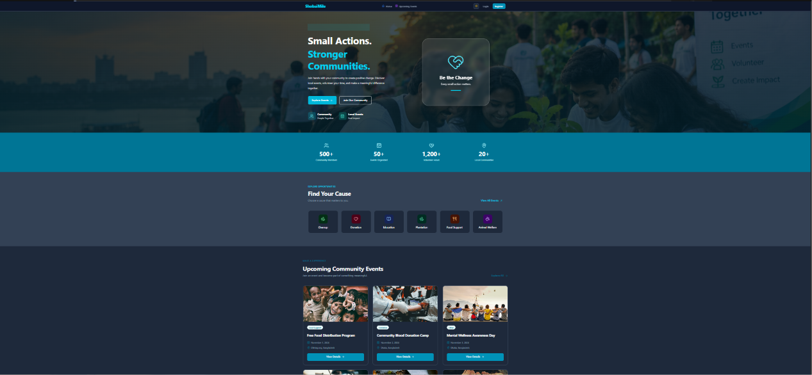

# 🌍 ShobaiMile — Volunteer Community Platform

### 🤝 Connect People • Empower Communities • Create Positive Change

**ShobaiMile** is a community-focused volunteer platform designed to connect people with volunteering opportunities and encourage meaningful social engagement. It provides a modern digital experience where users can explore community events, participate in volunteer activities, track their impact, and celebrate their contributions.

Built with modern web technologies, ShobaiMile focuses on a clean user interface, organized event management, and an engaging experience across different devices.

🔗 **Live Website:** [https://shobaimile.vercel.app/](https://shobaimile.vercel.app/)

---

## 📸 Project Screenshot

Showcase the ShobaiMile user interface below.

<!-- Add your actual project screenshot to the repository -->



---

## ✨ Key Features

### 🤝 1. Volunteer Community
- Discover community-focused volunteering opportunities.
- Explore events and activities that encourage social participation.
- Help users connect with meaningful community initiatives.

### 📅 2. Event Discovery
- Browse available community events.
- View individual event details.
- Explore activities through organized event pages.

### 👤 3. User Authentication
- Login and registration pages.
- Authentication integration through dedicated authentication modules.
- Access to user-related features where authentication is required.

### 📝 4. Event Management
- Dedicated event creation page.
- Event management interface.
- Individual event detail pages for displaying relevant information.

### 🙋 5. Joined Events
- Dedicated page for joined events.
- A centralized place to access relevant event participation information.

### 📊 6. Impact Dashboard
- Dedicated impact dashboard.
- Components for displaying impact statistics and progress.
- Visual representation of volunteer contributions.

### 🏆 7. Certificates
- Dedicated certificates page.
- Reusable certificate card components.
- A structured interface for displaying volunteer recognition.

### 🥇 8. Leaderboard
- Dedicated leaderboard page.
- A platform structure that supports community recognition and engagement.

### 👤 9. User Profile
- Dedicated profile page.
- A centralized interface for user-related information.

### 🎨 10. Modern User Interface
- Clean and organized layouts.
- Reusable UI components.
- Consistent styling across different sections.

### 📱 11. Responsive Experience
- Designed for different screen sizes.
- Flexible page layouts.
- A convenient browsing experience across supported devices.

### ⚡ 12. Organized Application Architecture
- Next.js App Router for page routing.
- TypeScript for type-safe development.
- Shared components and utility modules for maintainable code.

---

## 🛠️ Technology Stack

| Technology | Purpose |
|---|---|
| Next.js | Application framework and routing |
| React | Component-based user interfaces |
| TypeScript | Type-safe application development |
| MongoDB | Database integration |
| Better Auth | Authentication integration |
| CSS | Application styling |
| Reusable UI Components | Consistent interface elements |
| Vercel | Application deployment |
| Git & GitHub | Version control and source code management |

---

## 📂 Project Structure

```text
shobaimile-client/
├── public/
│   └── images/
│
├── src/
│   ├── app/
│   │   ├── api/
│   │   │   └── auth/
│   │   │       └── [...all]/
│   │   │           └── route.ts
│   │   │
│   │   ├── certificates/
│   │   │   └── page.tsx
│   │   │
│   │   ├── create-event/
│   │   │   └── page.tsx
│   │   │
│   │   ├── dashboard/
│   │   │   └── impact/
│   │   │       └── page.tsx
│   │   │
│   │   ├── events/
│   │   │   ├── [id]/
│   │   │   │   └── page.tsx
│   │   │   └── page.tsx
│   │   │
│   │   ├── home/
│   │   │   ├── CategoriesSection.tsx
│   │   │   ├── CommunityGallerySection.tsx
│   │   │   ├── CommunityStoriesSection.tsx
│   │   │   ├── CTASection.tsx
│   │   │   ├── FeaturesSection.tsx
│   │   │   ├── HeroSection.tsx
│   │   │   ├── HowItWorksSection.tsx
│   │   │   ├── ImpactSection.tsx
│   │   │   ├── NewsletterSection.tsx
│   │   │   └── UpcomingEventsSection.tsx
│   │   │
│   │   ├── joined-events/
│   │   │   └── page.tsx
│   │   │
│   │   ├── leaderboard/
│   │   │   └── page.tsx
│   │   │
│   │   ├── login/
│   │   │   └── page.tsx
│   │   │
│   │   ├── manage-events/
│   │   │   └── page.tsx
│   │   │
│   │   ├── profile/
│   │   │   └── page.tsx
│   │   │
│   │   ├── register/
│   │   │   └── page.tsx
│   │   │
│   │   ├── globals.css
│   │   ├── layout.tsx
│   │   └── page.tsx
│   │
│   ├── components/
│   │   ├── certificates/
│   │   ├── impact/
│   │   ├── ui/
│   │   ├── Footer.tsx
│   │   ├── Navbar.tsx
│   │   └── ThemeProvider.tsx
│   │
│   ├── lib/
│   │   ├── api.ts
│   │   ├── auth-client.ts
│   │   ├── auth.ts
│   │   ├── mongodb.ts
│   │   └── utils.ts
│   │
│   └── proxy.ts
│
├── .gitignore
├── components.json
├── eslint.config.mjs
├── next.config.ts
├── package.json
├── package-lock.json
├── README.md
└── tsconfig.json
```

---

## 📁 Main Directory Overview

### `src/app/`
Contains application pages, layouts, global styles, and API routes using the Next.js App Router.

### `src/app/home/`
Contains reusable sections for the homepage, including the hero, features, community stories, impact, upcoming events, and newsletter sections.

### `src/app/events/`
Contains the events listing page and dynamic event detail routes.

### `src/app/create-event/`
Provides the page for creating community events.

### `src/app/joined-events/`
Contains the joined-events page.

### `src/app/manage-events/`
Contains the event management interface.

### `src/app/dashboard/impact/`
Contains the volunteer impact dashboard page.

### `src/app/certificates/`
Contains the certificates page.

### `src/app/leaderboard/`
Contains the leaderboard page.

### `src/app/profile/`
Contains the user profile page.

### `src/components/`
Stores reusable interface components, including the navbar, footer, certificate components, impact components, and UI elements.

### `src/lib/`
Contains shared utilities, API helpers, authentication modules, and MongoDB integration.

### `src/app/api/`
Contains API route handlers, including the authentication route.

### `public/`
Stores static assets such as images and icons.

---

## 🚀 Getting Started

Follow these instructions to run the project locally.

### Prerequisites

Install the following tools:

- [Node.js](https://nodejs.org/)
- npm
- [Git](https://git-scm.com/)
- A code editor such as Visual Studio Code

### 1. Clone the Repository

```bash
git clone YOUR_GITHUB_REPOSITORY_URL
```

### 2. Navigate to the Project Directory

```bash
cd shobaimile-client
```

### 3. Install Dependencies

```bash
npm install
```

### 4. Configure Environment Variables

Create a `.env` file in the project root and configure the environment variables required by the application.

For example, if required by your project:

```env
MONGODB_URI=your_mongodb_connection_string
```

Add any other required authentication or service configuration values according to your implementation.

**Security:** Never commit database credentials, authentication secrets, or private API keys to a public repository.

### 5. Run the Development Server

```bash
npm run dev
```

Open the local address displayed in your terminal to access the application.

### 6. Build the Application

```bash
npm run build
```

### 7. Run the Production Server

After a successful production build, run:

```bash
npm run start
```

---

## 🎯 Project Goals

ShobaiMile aims to:

- Make volunteering opportunities easier to discover.
- Encourage participation in community activities.
- Provide a centralized interface for community events.
- Help users explore and manage event participation.
- Present volunteer impact through statistics and progress components.
- Recognize volunteer contributions through certificates and leaderboards.
- Deliver a modern, responsive, and accessible user experience.

---

## 🔮 Future Improvements

Potential enhancements for future versions include:

- 🔎 Advanced event search and filtering.
- 📍 Location-based volunteer opportunities.
- 📅 Event calendars and reminders.
- 🔔 Notifications for event updates.
- 📊 More detailed volunteer analytics.
- 🏅 Expanded volunteer achievement and recognition features.
- 👤 Enhanced profile customization.
- 📱 Further mobile usability improvements.
- 🛡️ Additional security and access-control enhancements.

---

## 🌐 Live Demo

Explore the deployed application:

### 👉 [Visit ShobaiMile](https://shobaimile.vercel.app/)

---

## 👨‍💻 Developer

**Project:** ShobaiMile  
**Category:** Volunteer Community Platform  
**Deployment:** Vercel  
**Live Website:** https://shobaimile.vercel.app/

Developed with ❤️ to encourage volunteering, community engagement, and positive social change.

---

## 📄 License

Unless another license is specified in the repository, this project is presented for educational and portfolio purposes.

---

### ⭐ Support the Project

If you find this project interesting, consider giving the repository a star on GitHub.

**Together, we can make a difference—one helping hand at a time.**
